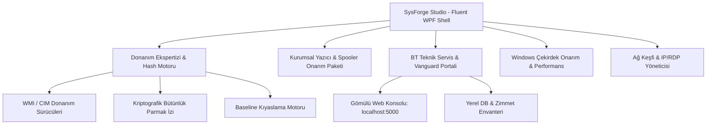

# 🛠️ SysForge Studio — Enterprise IT & Hardware Diagnostic Suite

[](https://microsoft.com/windows)
[]()
[]()
[]()
[](LICENSE)

**SysForge Studio**, bilgi işlem profesyonelleri, sistem yöneticileri ve teknik servis teknisyenleri için geliştirilmiş; donanım kimlik doğrulama, parça değişikliği tespiti, kurumsal yazıcı onarımı ve BT operasyonlarını tek çatı altında toplayan hepsi bir arada Windows bakım merkezidir.

Windows 11 / DevToys ve PowerToys tasarım ilkelerine sadık kalınarak modern, akıcı ve koyu Fluent XAML arayüzü ile sıfırdan tasarlanmıştır.

---

## 🏛️ Mimari Şeması



---

## ✨ Temel Modüller ve Yetenekler

### 🛡️ 1. Donanım Ekspertizi & Bütünlük Kıyaslama (Hardware Expertise)
* **Derinlemesine Donanım Envanteri:** Anakart Seri No, BIOS UUID, İşlemci ID, RAM modülleri (Bank, Seri No, Kapasite, Hız), Diskler (Seri No, Model, Kapasite) ve GPU dökümü.
* **Kriptografik SHA-256 Parmak İzi:** Cihazın benzersiz donanım seri numaralarından deterministik donanım hash'i üretir.
* **Referans Baseline Kaydı & Değişiklik Tespiti:** Cihaz servise alındığında tek tıkla referans kayıt oluşturulur. Teslimat öncesi kıyaslama yapılarak sökülen, eklenen veya değiştirilen parçalar (örn. RAM modülü, değişen SSD) anında renkli Fluent kartlarla uyarılır.
* **HTML Ekspertiz Raporu:** Müşteriye veya arşive sunulmak üzere tek tıkla görselleştirilmiş teknik servis raporu üretir.

### 🖨️ 2. Kurumsal Yazıcı Onarım Paketi
* **0x0000011b, 709 ve Point & Print Çözümleri:** Windows güncellemeleri sonrası ağ yazıcılarında oluşan RPC ve SMB kimlik doğrulama hatalarını otomatik onarır.
* **Spooler & Kuyruk Temizliği:** Yazdırma biriktiricisini sıfırlar, takılı kalmış geçici yazdırma dosyalarını temizler.
* **Sürücü İzolasyonu:** Hatalı veya çakışan yazıcı sürücü paketlerini marka bazında filtreler ve kaldırır.

### 💼 3. BT Teknik Servis & Vanguard Portali (IT Service)
* **Arıza & Destek Talepleri (Tickets):** Şirket içi veya müşteri destek çağrılarını yönetme.
* **Cihaz Zimmet Takibi:** Donanım envanterini kullanıcılara zimmetleme.
* **Yerel Web Konsolu:** Entegre Flask web sunucusunu doğrudan masaüstü arayüzünden başlatma ve tarayıcıda (`http://localhost:5000`) yönetme.

### ⚡ 4. Bağımsız Modern WPF PowerShell Desteği
* `EkspertizRaporu_WPF_Fluent.ps1` betiği, eski Windows Forms yerine doğrudan yerel **Windows Presentation Foundation (WPF)** motorunu kullanarak harici hiçbir DLL olmadan modern koyu temada bağımsız çalışabilir.

---

## 💻 Sistem Gereksinimleri

* **İşletim Sistemi:** Windows 10 (Sürüm 1809 veya üstü), Windows 11, Windows Server 2019/2022
* **Mimari:** x86 (32-bit) ve x64 (64-bit) tam destek
* **Yetki:** Yönetici (Administrator) ayrıcalıkları gereklidir (WMI ve Windows servis kontrolleri için)

---

## 🚀 Derleme & Dağıtım

### Tek Tıkla Çoklu Mimari Paketleme:
Depo kök dizininde yer alan derleme betiğini çalıştırın:

```cmd
Publish_All_Architectures.bat
```

Bu işlem:
* `publish_output\win-x64\` klasörüne 64-bit tek parça portable `.exe`
* `publish_output\win-x86\` klasörüne 32-bit tek parça portable `.exe`
çıktılarını otomatik olarak derler.

### Visual Studio ile Geliştirme:
1. `UltimateToolkit.sln` çözüm dosyasını Visual Studio 2022+ ile açın.
2. `Release | Any CPU` veya `Release | x64` seçeneğiyle derleyin.

---

## 📄 Lisans

Bu proje [MIT Lisansı](LICENSE) kapsamında açık kaynak olarak yayımlanmıştır.