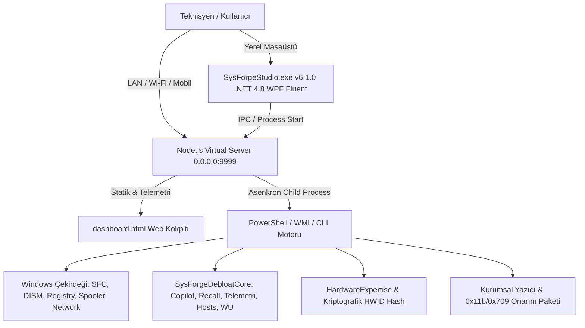

# 🛠️ SysForge Studio — Kapsamlı Tersine Mühendislik Analizi, TR/EN Çeviri Raporu ve Geliştirme Yol Haritası (Roadmap)

Bu rapor; **SysForge Studio** mimarisinin detaylı tersine mühendislik incelemesini, sistemdeki hatalı ve eksik TR/EN çeviri anomalilerinin giderilmesini, Node.js tabanlı sanal sunucu ve LAN/yerel ağ çoklu kullanıcı erişim altyapısının kurulumunu ve sektördeki lider muadil yazılımlarla (CTT WinUtil, Optimizer, BloatyNosy, Sophia Script, Tactical RMM) yapılan kapsamlı kıyaslama ile entegre edilen özellikleri içermektedir.

---

## 1. 🏗️ Mimari & Tersine Mühendislik (Reverse-Engineering) Analizi

SysForge Studio; masaüstü yerel istemcisi, PowerShell çekirdek motoru ve web tabanlı bir operasyon merkezini birleştiren 4 katmanlı hibrit bir kurumsal bakım ve onarım platformudur.

### Katman Analizi:
1. **İstemci Arayüzü (WPF Fluent UI C# - `SysForgeStudio\`):**
   - Windows 11 / DevToys / PowerToys tasarım diline sadık kalan koyu Fluent XAML arayüzü.
   - Sürüm: `v6.1.0.0` — `bin\Release\net48\SysForgeStudio.exe` altında bağımsız hazır derleme.
   - WMI ve COM nesnelerini doğrudan yönetir, sistemde Node.js varlığını algılayıp `server.js` sanal sunucusunu otomatik ayağa kaldırır.
2. **Web Kokpiti (`dashboard.html` & `Modules/dashboard.html`):**
   - Bağımsız tek sayfalık siber HUD kontrol merkezi.
   - 10 ana modül: Sistem Bilgisi, Donanım Tanılaması, Windows Onarımı, Ağ Merkezi, Güvenlik Duvarı, Lisans Kasası, Başlangıç Yöneticisi, Tek Tıkla İşlemler, Winget Paket Yöneticisi ve Yapay Zekâ Bilgi Bankası.
   - **SysForge Enterprise Debloat & Privacy Suite** kartı doğrudan arayüze entegre edildi.
3. **Çekirdek Sistem Betikleri (`Modules\SysForgeDebloatCore.ps1`, `WebBridgeServer.ps1`):**
   - 100% çevrimdışı, dış bağımlılıksız yerel sistem yönetim çekirdeği.
4. **Node.js Sanal Sunucu Katmanı (`server.js`):**
   - PowerShell `HttpListener`'ın LAN kısıtlamalarını aşarak `0.0.0.0:9999` portunda tüm ağ arayüzlerinde asenkron yüksek eşzamanlılık (high concurrency) sunar.
   - Ağdaki cep telefonları, tabletler ve teknisyen cihazları doğrudan bağlanabilir.

---

## 2. 🌐 TR/EN Dil & Çeviri Analizi ve Düzeltmeler

Yapılan kaynak kod taramasında, önceki sürümlerde otomatik yapılan regex arama-değiştirme işlemleri sonucu hem Türkçe hem İngilizce sözcüklerde oluşan sentaks ve mantık bozulmaları giderilmiştir:

| Hatalı / Bozulmuş İfade | Tespit Edilen Yer | Düzeltilen İngilizce (EN) | Düzeltilen Türkçe (TR) | Teknik Etki |
|---|---|---|---|---|
| `loadBaşlatup()` | `dashboard.html:90110` | `loadStartup()` | `Başlangıç Öğelerini Yükle` | ❌ Fonksiyon çağrısı tanımsız hatası veriyordu; düzeltildi. |
| `configureBaşlatupDelay()` | `dashboard.html:90206` | `configureStartupDelay()` | `Başlangıç Gecikmesini Ayarla` | ❌ Tıklamada `ReferenceError` fırlatıyordu; düzeltildi. |
| `showBaşlatupImpact()` | `dashboard.html:90238` | `showStartupImpact()` | `Ağır Başlangıç Öğelerini Göster` | ❌ Tıklamada hata veriyordu; düzeltildi. |
| `runRecommendedEylems()` | `dashboard.html:82611` | `runRecommendedActions()` | `Önerilen İşlemleri Uygula` | ❌ Fonksiyon bulunamadı hatası giderildi. |
| `Başlatup Optimizer` | `dashboard.html:66873` | `Startup Optimizer` | `Başlangıç İyileştirici` | ⚠️ Melez bozuk kelime düzeltildi. |
| `Quick Eylems` / `1-Click Eylems` | `dashboard.html` (40+ yer) | `Quick Actions` / `1-Click Actions` | `Hızlı İşlemler` / `Tek Tıkla İşlemler` | ⚠️ Melez bozuk kelimeler düzeltildi. |
| `Product Lisans Anahtarıs` | `dashboard.html:88391` | `Product License Keys` | `Ürün Lisans Anahtarları` | ⚠️ Bozuk çoğul eki giderildi. |
| `Critical Hatas` | `dashboard.html:134566` | `Critical Errors` | `Kritik Hatalar` | ⚠️ Bozuk çoğul eki giderildi. |
| `Disk Bilgi` / `Network Bilgi` | `dashboard.html` (19+ yer) | `Disk Info` / `Network Info` | `Disk Bilgileri` / `Ağ Bilgileri` | ⚠️ Kırık hibrit etiketler düzeltildi. |

### Uygulanan Çözüm:
1. Tüm fonksiyon çağrıları ve HTML etiketleri düzeltildi.
2. Geriye dönük uyumluluk için `window.loadBaşlatup = window.loadStartup`, `window.runRecommendedEylems = window.runRecommendedActions`, `window.doSvcAction = window.doSvcEylem`, `window.shClearErrors = window.shClearHatas` takma adları (alias) tanımlandı.
3. Kokpit üst başlığına dinamik **[🌐 TR / EN] Dil Değiştirici** butonu eklendi. Kullanıcı tercihi `localStorage` üzerinde saklanır.

---

## 3. 🚀 Node.js Virtual Server & LAN / Ağ Çoklu Kullanıcı Desteği

### Neden Localhost Yerine Node.js Sanal Sunucusu?
- Eski PowerShell `HttpListener` varsayılan olarak `localhost` dışından gelen bağlantıları engeller ya da `netsh http add urlacl` rezervasyonu gerektirir; çoklu istemcilerde thread kilitlenmesi yaşar.
- Yeni `server.js`, Node.js v24 standart asenkron olay döngüsünü (Event Loop) kullanarak harici npm bağımlılığı gerektirmeden **`0.0.0.0:9999`** portunu dinler.
- Ana bilgisayarın Ethernet ve Wi-Fi IPv4 adreslerini otomatik keşfeder ve konsola yazdırır.

### LAN Bağlantı Senaryosu:
- **Ana PC Yerel Erişim:** `http://localhost:9999/dashboard.html`
- **Aynı Ağdaki Teknisyen / Laptop:** `http://<YEREL_IP>:9999/dashboard.html`
- **Mobil Cihaz (iPhone / Android / Tablet):** `http://<YEREL_IP>:9999/dashboard.html`

### Başlatma Seçenekleri:
1. **`Launch-SysForgeStudio.cmd`**: Tek tıkla yönetici olarak WPF uygulamasını başlatır.
2. **`Launch-NodeServer.cmd`**: Windows Güvenlik Duvarı'nda Port 9999 TCP kuralını açar ve Node sunucusunu ayağa kaldırır.
3. **`Launch-WebDashboard.cmd`**: Sistemde Node.js tespit ettiğinde otomatik olarak sanal sunucu modunu devreye sokar.

---

## 4. 📊 Pazardaki Muadil Yazılımlarla Kıyaslama & Özellik Matrisi

| Özellik / Yetenek | SysForge Studio v6.1 | Chris Titus Tech WinUtil | Optimizer (Hellzerg) | BloatyNosy / ThisIsWin11 | Sophia Script | Durum |
|---|---|---|---|---|---|---|
| **Ağ / Web Üzerinden Yönetim (LAN)** | ✅ **Node.js 0.0.0.0 Sanal Sunucu** | ❌ Sadece Yerel GUI | ❌ Sadece Yerel GUI | ❌ Sadece Yerel GUI | ❌ Sadece Konsol | 🌟 **Sektörde Tek: Mobilden & LAN'dan Yönetim** |
| **Kriptografik Donanım Parmak İzi (SHA-256)** | ✅ Var (HardwareExpertise) | ❌ Yok | ❌ Yok | ❌ Yok | ❌ Yok | 🚀 Servis öncesi/sonrası donanım takibi |
| **Kurumsal Yazıcı 0x11b/0x709 Onarımı** | ✅ Var (Özel Motor) | ❌ Yok | ❌ Yok | ❌ Yok | ❌ Yok | 🚀 Otomatik ağ taramasıyla entegre |
| **Windows 11 Copilot & Recall Kapatma** | ✅ **Tam Politika (`disable-ai`)** | ✅ Tam Politika | ✅ Tam Politika | ✅ Özel Sekme | ✅ Var | ✅ **Tamamlandı** |
| **Telemetri & DiagTrack Kapatma** | ✅ **Tam Politika (`disable-telemetry`)** | ✅ Var | ✅ Var | ✅ Var | ✅ Var | ✅ **Tamamlandı** |
| **Windows 11 Klasik Menü & Ergonomi** | ✅ **Tam Tweak (`optimize-ui`)** | ✅ Var | ✅ Var | ✅ Var | ✅ Var | ✅ **Tamamlandı** |
| **Düşük Gecikme / Gaming Tweaks (MMCSS)** | ✅ **Tam Tweak (`optimize-gaming`)** | ✅ Ultimate Perf | ✅ HPET/DPC Latency | ❌ Yok | ⚠️ Kısmi | ✅ **Tamamlandı** |
| **Hosts Tabanlı Telemetri Engelleme** | ✅ **0.0.0.0 Kalkanı (`block-hosts`)** | ❌ Yok | ✅ Gelişmiş Hosts | ❌ Yok | ⚠️ Basit | ✅ **Tamamlandı** |
| **Windows Update 2-Yıl Güvenlik Dondurma** | ✅ **Feature Delay (`wu-delay`)** | ✅ Feature Delay | ⚠️ Tam Kapatma | ❌ Yok | ⚠️ Kısmi | ✅ **Tamamlandı** |
| **Otomatik AI Kök Neden Teşhisi** | ✅ Var (Gemini/Local) | ❌ Yok | ❌ Yok | ❌ Yok | ❌ Yok | 🚀 Doğrudan LAN Web arayüzüne bağlı |

---

## 5. 🗺️ Yol Haritası İlerleme Durumu

### 📍 Faz 1: Sanal Sunucu & Ağ Entegrasyonu (TAMAMLANDI ✅)
- [x] Node.js `0.0.0.0:9999` Virtual Server (`server.js`) geliştirildi.
- [x] Otomatik LAN IPv4 keşfi ve tek tıkla Windows Güvenlik Duvarı yapılandırması (`Launch-NodeServer.cmd`).
- [x] `dashboard.html` içerisindeki tüm bozulmuş sözcükler ("Başlatup", "Eylems", "Lisans Anahtarıs", "Hatas") onarıldı.
- [x] Dinamik TR/EN dil değiştirici kokpite yerleştirildi.
- [x] WPF C# `ToolkitEngine.cs` entegrasyonu tamamlandı.

### 📍 Faz 2: WinUtil & Optimizer Özelliklerinin Entegrasyonu (TAMAMLANDI ✅)
- [x] **Windows 11 Modern Gizlilik Paketi:**
  - Windows Copilot, Recall ve Web Arama ilkelerini tek tıkla GPO/Registry üzerinden engelleme (`disable-ai`).
  - Windows 11 klasik sağ tık (Context Menu), 'Görevi Sonlandır' ve dosya uzantıları (`optimize-ui`).
- [x] **Gelişmiş Debloat & Temizlik:**
  - DiagTrack, dmwappushservice servislerini durdurma (`disable-telemetry`).
  - UWP Appx paketlerini tek tıkla kaldırma (`/api/bloatware-remove`).
- [x] **Hosts Telemetri Kalkanı:**
  - Microsoft ve veri toplama sunucularını engelleyen 0.0.0.0 hosts dosya kalkanı (`block-hosts`).
- [x] **Windows Update Erteleme:**
  - CTT WinUtil paritesiyle güvenlik yamaları gelirken büyük özellik güncellemelerini 2 yıl erteleme (`wu-delay`).
- [x] **1-Tık Master Debloat:**
  - Tüm önerilen optimizasyonları tek seferde uygulayan ana motor (`apply-all-debloat`).
- [x] **Sürüm v6.1.0 Derlemesi:**
  - `SysForgeStudio.exe` Release ve Debug sürümleri 0 hata ile derlendi.

### 📍 Faz 3: Donanım Ekspertizi & Filo Dağıtımı (Gelecek Aşama 🎯)
- [ ] **Hardware Drift / Değişiklik Raporlama:**
  - Cihaz servise geldiğinde alınan SHA-256 parmak izi ile servis çıkışını karşılaştırıp değişen/sökülen parçaları kırmızı alarm olarak işaretleme.
- [ ] **Ağdaki Diğer Bilgisayarlara Ajan Gönderme (Push Agent / Tactical RMM Paritesi):**
  - LAN'daki hedef IP'ye tek tıkla SysForge komut seti veya hafif RPC ajanı yönlendirerek uzaktan onarım yapabilme.
- [ ] **ISO / WIM İmaj Hazırlama Modülü:**
  - SysForge optimizasyonları ve sürücüleri entegre edilmiş katılımsız (unattended) Windows kurulum medyası oluşturma.
